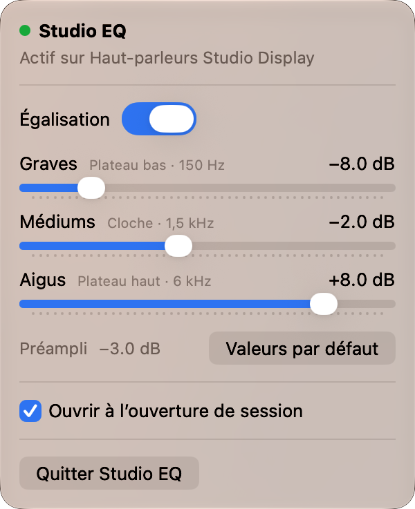

# Studio EQ

[English](README.md) · **Français**

Petite app de barre des menus pour macOS qui égalise automatiquement le son **uniquement quand
les haut-parleurs d'un Apple Studio Display sont la sortie audio du système**. Elle n'utilise
aucun pilote audio virtuel, aucun réseau et aucune dépendance externe.

<p align="center">
  
</p>

- Studio Display sélectionné → égalisation active.
- AirPods, haut-parleurs du Mac, autre sortie, écran débranché → égalisation inactive, son intact.
- Bascule automatique à chaque changement, reprise au branchement, au réveil et à l'ouverture de
  session (option).
- Réglages par défaut : graves −6 dB, médiums +3 dB, aigus +2 dB. Ils sont modifiables et
  conservés d'une session à l'autre.

## Installer

Téléchargez le DMG de la dernière version dans les
[Releases](https://github.com/phocean/studio-eq/releases), ouvrez-le et glissez Studio EQ dans
Applications. L'app est signée Developer ID et notarisée par Apple.

Documentation : [faisabilité et choix du moteur](docs/FAISABILITE.md) ·
[architecture](docs/ARCHITECTURE.md) · [paramètres DSP](docs/DSP.md) ·
[compte rendu de tests](docs/TESTS.md) · [revues de code](docs/revues/SYNTHESE.md) ·
[publier une version](docs/RELEASE.md) · [limitations](#limitations).

## Prérequis

- Mac Apple Silicon, **macOS 15 ou plus récent** (les process taps exigent macOS 14.2 ; 15
  est requis pour `Synchronization.Atomic`). Validé sur macOS 27.3.
- Pour compiler : Xcode 26 ou plus récent (validé avec Xcode 26.6 en CI et 27.2 en local) et
  [XcodeGen](https://github.com/yonaskolb/XcodeGen) (`brew install xcodegen`) : le projet Xcode
  est généré à partir de `project.yml` et n'est pas versionné.

## Compiler depuis les sources

```bash
make install
```

`make install` génère le projet, compile en Release, vérifie la signature, copie l'app dans
`dist/` et dans `/Applications`, puis la lance ; rien n'est installé si la compilation
échoue. `make help` liste les autres cibles : `build`, `test`, `validation`, `selftest`,
`scenario`, `dmg`, `release`, `publish`, `clean`. Pour travailler dans Xcode : `make project`, puis
ouvrez `StudioEQ.xcodeproj` (schéma `StudioEQ`, ⌘U pour les tests).

Signature : par défaut **ad hoc**, sans compte développeur. Pour signer avec votre identité,
copiez `Config/Local.xcconfig.example` en `Config/Local.xcconfig` (ignoré par git) et
renseignez-le. macOS rattache l'autorisation audio à la signature : une app signée autrement
(ou, en ad hoc, chaque nouvelle compilation) redemande l'autorisation.
Si une version signée différemment a déjà tourné sur le Mac, macOS demande aussi, au premier
lancement, d'autoriser l'accès aux réglages qu'elle a laissés (« diffère des versions
précédemment ouvertes »).

## Premier lancement

1. L'icône (cadran) apparaît dans la barre des menus.
2. Quand le Studio Display devient la sortie, macOS demande l'autorisation d'**enregistrer
   l'audio du système**. Elle est indispensable pour relire le son destiné à l'écran. Rien n'est
   enregistré ni transmis.
3. Si l'autorisation est refusée, Studio EQ **ne coupe rien** : le son reste normal et le menu
   l'indique, avec un bouton vers Réglages Système › Confidentialité et sécurité ›
   Enregistrement de l'écran et de l'audio du système. Une fois l'autorisation accordée, cliquez
   « Réessayer ».
4. Cochez « Ouvrir à l'ouverture de session » si vous le souhaitez.

## Menu

État (actif, inactif et pourquoi, erreur) · interrupteur Égalisation · Graves / Médiums / Aigus
(±12 dB, pas de 0,5 dB) · préampli fixe affiché (−3 dB) · Valeurs par défaut · Ouvrir à
l'ouverture de session · Masquer l'icône sans Studio Display · Quitter (⌘Q).

Avec « Masquer l'icône sans Studio Display », l'icône quitte la barre des menus tant que l'écran
est débranché, puisqu'il n'y a alors rien à régler, et revient quand il est rebranché. Pour la
retrouver entre-temps, ouvrir à nouveau Studio EQ (Finder, Spotlight).

Chaque curseur ne modifie que sa bande : le préampli est fixe, il ne compense pas les
réglages. Un limiteur de crête en sortie empêche toute saturation, même avec de fortes
accentuations.

## Désinstaller

Quittez l'app, décochez l'ouverture de session si besoin, puis supprimez
`/Applications/StudioEQ.app` et éventuellement `~/Library/Containers/com.jcbaptiste.StudioEQ`.
Pour remettre l'autorisation à zéro :

```bash
tccutil reset AudioCapture com.jcbaptiste.StudioEQ
```

## Limitations

- **Autorisation retirée pendant l'égalisation** (Réglages Système) : le son continue (vérifié).
  L'autorisation est revérifiée avant **chaque** montage du moteur (changement de sortie, de
  fréquence, réveil, interrupteur) : un refus y est détecté sans couper le son.
- **Latence ajoutée mesurée : 4,2 ms** à 48 kHz. Les lecteurs vidéo ne la compensent pas, car
  ils ne la connaissent pas ; elle reste très en dessous du seuil de perception de la
  synchronisation labiale (≈ 45 ms).
- À chaque montage du moteur (passage vers le Studio Display, changement de fréquence, réveil),
  0,2 à 0,6 s de son passent non traitées : c'est le temps de la vérification de l'autorisation,
  faite avant de couper quoi que ce soit. Après une lecture, l'E/S reste active : ≈ 0,3 % d'un cœur.
- Le son d'**une app qui choisit elle-même le Studio Display** alors que la sortie système est
  ailleurs n'est pas égalisé : c'est voulu, seule la sortie système déclenche l'égalisation.
- Les sons d'alerte suivent la « sortie des effets sonores » de macOS. S'ils vont vers l'écran
  pendant que l'égalisation est active, ils sont égalisés eux aussi.
- La reconnaissance du Studio Display repose sur les identifiants USB relevés sur un exemplaire
  (`Studio Display Audio Control:05AC:1114`). Un futur modèle avec un autre nom de produit USB
  ne serait pas reconnu sans mise à jour.
- Une seule instance tourne à la fois : une seconde copie lancée (depuis le DMG par exemple)
  se ferme aussitôt sans toucher au son. Avec le changement rapide d'utilisateur, Studio EQ
  n'égalise que dans la session au premier plan.
- Avec de fortes accentuations (au-delà de +3 dB au total) sur une musique déjà au maximum, le
  limiteur de sortie baisse le niveau un instant : pas de saturation ni de distorsion ajoutée,
  mais les passages les plus forts sont légèrement compressés.
- Les tests matériels encore à faire sont listés dans [TESTS.md](docs/TESTS.md).

## Licence

Copyright © 2026 Jean-Christophe Baptiste.

Studio EQ est un logiciel libre : vous pouvez le redistribuer et le modifier selon les termes de
la **GNU General Public License, version 2 ou (à votre choix) toute version ultérieure**, telle
que publiée par la Free Software Foundation. Il est distribué sans aucune garantie. Texte
complet : [LICENSE](LICENSE). Identifiant SPDX : `GPL-2.0-or-later`.
