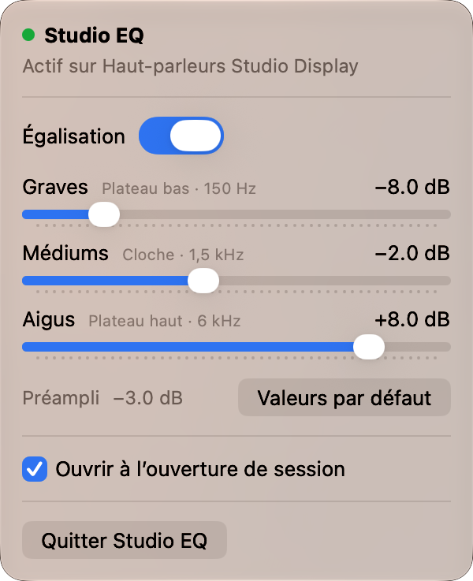

# Studio EQ

**English** · [Français](README.fr.md)

A small macOS menu bar app that automatically equalizes the sound **only while the speakers of
an Apple Studio Display are the system audio output**. It uses no virtual audio driver, no
network and no third-party dependency.

<p align="center">
  
</p>

- Studio Display selected → equalization on.
- AirPods, Mac speakers, any other output, display unplugged → equalization off, sound untouched.
- Switches automatically on every change, and resumes when the display is plugged in, after
  sleep and at login (optional).
- Default settings: bass −6 dB, mids +3 dB, treble +2 dB. They can be changed and are kept
  across sessions.

## Install

Download the DMG of the latest version from
[Releases](https://github.com/phocean/studio-eq/releases), open it and drag Studio EQ to
Applications. The app is signed with Developer ID and notarized by Apple.

Documentation (in French): [feasibility and engine choice](docs/FAISABILITE.md) ·
[architecture](docs/ARCHITECTURE.md) · [DSP parameters](docs/DSP.md) ·
[test report](docs/TESTS.md) · [code reviews](docs/revues/SYNTHESE.md) ·
[publishing a release](docs/RELEASE.md) · [limitations](#limitations).

## Requirements

- Apple Silicon Mac, **macOS 15 or later** (process taps need macOS 14.2; 15 is required for
  `Synchronization.Atomic`). Validated on macOS 27.3.
- To build: Xcode 26 or later (validated with Xcode 26.6 in CI and 27.2 locally) and
  [XcodeGen](https://github.com/yonaskolb/XcodeGen) (`brew install xcodegen`): the Xcode project
  is generated from `project.yml` and is not versioned.

## Build from source

```bash
make install
```

`make install` generates the project, builds Release, checks the signature, copies the app to
`dist/` and `/Applications`, then launches it; nothing is installed if the build fails.
`make help` lists the other targets: `build`, `test`, `validation`, `selftest`, `scenario`,
`dmg`, `release`, `publish`, `clean`. To work in Xcode: `make project`, then open
`StudioEQ.xcodeproj` (scheme `StudioEQ`, ⌘U for tests).

Signing: **ad hoc** by default, no developer account needed. To sign with your own identity,
copy `Config/Local.xcconfig.example` to `Config/Local.xcconfig` (ignored by git) and fill it
in. macOS ties the audio permission to the signature: an app signed differently (or, ad hoc,
every new build) asks for the permission again. If a differently signed copy already ran on the
Mac, macOS also asks on first launch to allow access to the settings it left behind ("differs
from previously opened versions").

## First launch

1. The icon (a dial) appears in the menu bar.
2. When the Studio Display becomes the output, macOS asks for permission to **record system
   audio**. It is required to process the sound headed to the display. Nothing is recorded or
   sent anywhere.
3. If the permission is denied, Studio EQ **mutes nothing**: the sound stays normal and the
   menu says so, with a button to System Settings › Privacy & Security › Screen & System Audio
   Recording. Once the permission is granted, click "Retry".
4. Check "Open at Login" if you wish.

## Menu

Status (active, inactive and why, error) · Equalization switch · Bass / Mids / Treble (±12 dB,
0.5 dB steps) · fixed preamp shown (−3 dB) · Reset to Defaults · Open at Login · Hide Icon
Without Studio Display · Quit (⌘Q).

With "Hide Icon Without Studio Display", the menu bar icon disappears while the display is
unplugged, since there is nothing to adjust then, and comes back when it is plugged in. To show
it in the meantime, open Studio EQ again (Finder, Spotlight).

Each slider only changes its own band: the preamp is fixed and does not compensate for the
settings. A peak limiter on the output prevents any clipping, even with strong boosts.

## Uninstall

Quit the app, uncheck Open at Login if needed, then delete `/Applications/StudioEQ.app` and
optionally `~/Library/Containers/com.jcbaptiste.StudioEQ`. To reset the permission:

```bash
tccutil reset AudioCapture com.jcbaptiste.StudioEQ
```

## Limitations

- **Permission revoked while equalizing** (System Settings): the sound keeps playing (verified).
  The permission is checked again before **every** engine start (output change, sample rate
  change, wake, switch), so a denial is caught there without muting the sound.
- **Measured added latency: 4.2 ms** at 48 kHz. Video players do not compensate for it, since
  they do not know about it; it stays far below the lip-sync perception threshold (≈ 45 ms).
- Each time the engine starts (switching to the Studio Display, sample rate change, wake),
  0.2 to 0.6 s of sound plays unprocessed: that is the time taken by the permission check, done
  before muting anything. After playback, I/O stays active: ≈ 0.3% of one core.
- Sound from **an app that picks the Studio Display itself** while the system output is
  elsewhere is not equalized: this is intended, only the system output triggers equalization.
- Alert sounds follow macOS's "Play sound effects through" output. If they go to the display
  while equalization is on, they are equalized too.
- The Studio Display is recognized by the USB identifiers read on one unit
  (`Studio Display Audio Control:05AC:1114`). A future model with a different USB product name
  would not be recognized without an update.
- Only one instance runs at a time: a second copy (launched from the DMG, for instance) quits
  immediately without touching the sound. With fast user switching, Studio EQ equalizes only in
  the session in front.
- With strong boosts (more than +3 dB in total) on music already at full scale, the output
  limiter turns the level down for a moment: no clipping and no added distortion, but the
  loudest passages are slightly compressed.
- Hardware tests still to be done are listed in [TESTS.md](docs/TESTS.md).

## License

Copyright © 2026 Jean-Christophe Baptiste.

Studio EQ is free software: you can redistribute it and/or modify it under the terms of the
**GNU General Public License, version 3 or (at your option) any later version**, as published by
the Free Software Foundation. It is distributed without any warranty. Full text:
[LICENSE](LICENSE). SPDX identifier: `GPL-3.0-or-later`.
